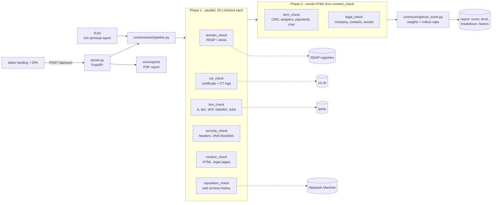

# DomainScan

Domain trust scanner: give it a domain, get a 0-100 Trust Score with an explainable breakdown - for anyone who needs to decide quickly whether a shop, payment page or "too good to be true" site is safe to deal with.

## Features

- Eight independent checks: domain registration (RDAP + whois fallback), DNS / mail setup, SSL certificate and CT logs, security headers and blocklists, page content, tech stack, legal info, web reputation.
- Weighted Trust Score with hard caps for critical red flags (blocklisted domain, expired or self-signed certificate, brand-new domain with hidden owner, no HTTPS).
- Top positive / negative factors so the score is explainable, not a black box.
- Three front-ends over one core: a rich terminal CLI, a FastAPI JSON API and a single-page web UI.
- PDF report export for any finished scan.
- Simple account system with a free daily scan limit and per-user scan history.

## Architecture



How it works:

1. The input is normalized and validated (`core/shared/validators.py`) - URLs, `www.` and paths are stripped down to a registrable domain.
2. Phase 1 runs six network checks concurrently with `asyncio`; each one has its own timeout, and a failing check degrades to `{"error": ...}` instead of breaking the scan.
3. Phase 2 reuses the HTML and headers fetched in phase 1 to detect the tech stack and legal information without extra requests.
4. The scorer turns raw signals into seven category scores (domain 0.20, legal 0.18, reputation 0.17, security 0.15, infrastructure 0.12, relations 0.10, tech 0.08), sums them and applies hard caps for critical flags.
5. The score maps to a level: trusted (85+), mostly OK (75+), caution (60+), high risk (40+), danger.

## Numbers

- 8 checks, 7 weighted score categories, 4 critical override rules.
- ~2.7k lines of Python, ~2.6k lines of static front-end (HTML/CSS/JS).
- 5 API endpoints: scan, PDF report, register, login, me.

## Tech stack

Python 3.11+, asyncio, httpx, dnspython, BeautifulSoup + lxml, tldextract, langdetect, mmh3 (favicon hashing), FastAPI + Uvicorn, Pydantic, fpdf2, rich. Front-end is plain HTML/CSS/JS without a build step.

## Project structure

```
.
├── cli.py              # terminal client: python3 cli.py <domain> [--json]
├── server.py           # FastAPI app: /api/scan, /api/report/{id}/pdf, /api/auth/*, serves static/
├── core/
│   ├── checks/         # one module per check (domain, dns, ssl, security, content, tech, legal, reputation)
│   ├── scanner/        # pipeline.py - orchestrates the two-phase scan
│   ├── scoring/        # trust_score.py - weights, caps, levels, top factors
│   ├── reports/        # pdf_report.py - PDF export
│   └── shared/         # http client, validators, detection signatures
├── static/             # landing page + scan UI (index.html, landing.js, landing.css)
├── Dockerfile          # python:3.11-slim + whois/dnsutils
├── requirements.txt
└── pyproject.toml
```

## Getting started

The scanner performs live network lookups (DNS, RDAP, HTTPS, public certificate and archive services), so it needs internet access. The system `whois` binary is used as a fallback when RDAP has no data.

```bash
python3 -m venv .venv && source .venv/bin/activate
pip install -r requirements.txt

# CLI
python3 cli.py --help
python3 cli.py example.com
python3 cli.py example.com --json

# API + web UI on http://localhost:8000
cp .env.example .env   # optional: set JWT_SECRET, PORT
python3 server.py
```

Scan over the API:

```bash
curl -s -X POST http://localhost:8000/api/scan \
  -H 'Content-Type: application/json' \
  -d '{"domain": "example.com"}'
```

Notes:

- Users, tokens and scan cache are kept in memory - restart wipes them. Swap in a real database before production use.
- There is no automated test suite yet.
- The Trust Score is an algorithmic estimate, not a legal verdict.

## License

MIT - see [LICENSE](LICENSE).
